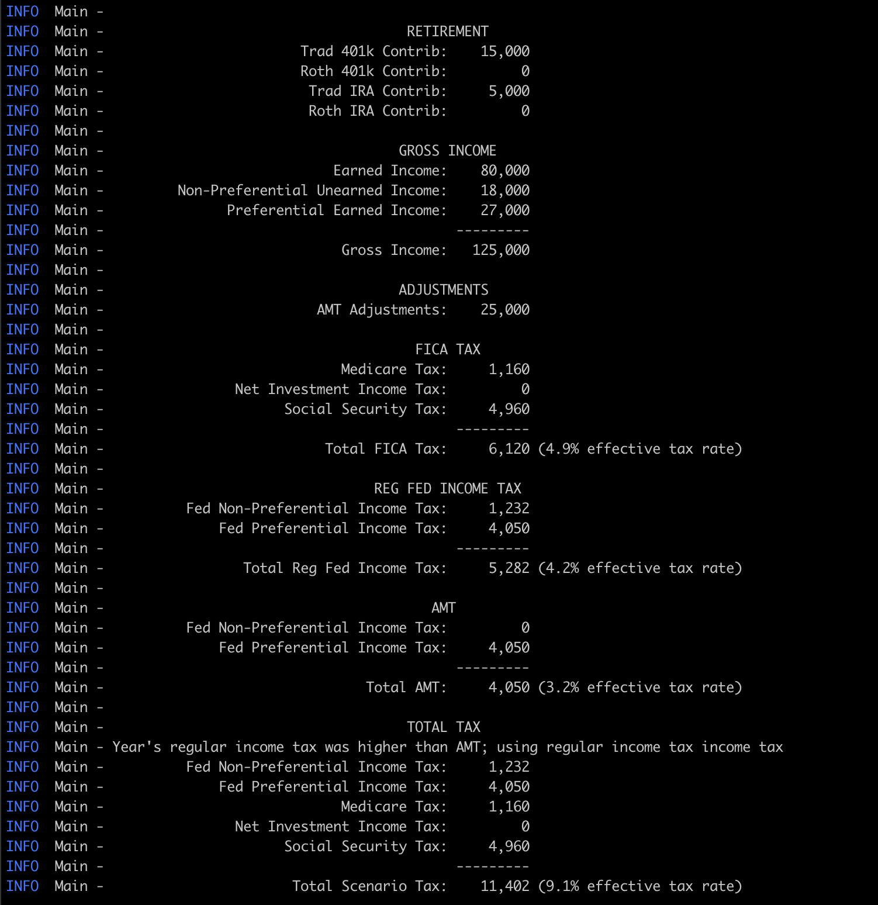

Wealthdraft
===========
A command-line tax and portfolio modelling tool I wrote to answer a question I couldn't get a straight answer to anywhere else: exactly how much federal tax will I owe this year, and which rules produced that number?

It calculates federal income tax and the Alternative Minimum Tax and charges whichever is higher, models employment tax and the Net Investment Income Tax, applies retirement and standard deductions in the order the rules actually require, and handles the foreign earned income exclusion. Around that core it grew a portfolio side: asset definitions, a small filter language, target-allocation drift tracking, and multi-year net worth projections under branching what-if scenarios.

Every input is a YAML file, so my entire financial model lives in version control.



*Sample output. Every section shown here is rendered from the example configs in `src/test/resources/examples/`.*

Why this exists
---------------
In the fall of 2020 a company I held equity in went public. I was about to owe a large, unfamiliar amount of tax on it, and estimated payments were due well before I understood how to compute the number.

The obvious move was to buy TurboTax and let Intuit work it out. But filing software produces one number on one day in April, and what I needed was to sit down in October and ask what happens to my liability if I exercise in November instead of January. That is a different question, and answering it meant understanding the rules myself rather than renting an answer from a company with no particular incentive to explain them.

So I went and read. IRS documentation first, then the enormous secondary literature that exists because the primary material is so hard to act on: practitioner analyses, explainer articles, forum threads where somebody had already hit the exact edge case I was staring at. A lot of those citations are still sitting in the code comments next to the rules they explain, which is the closest thing this project has to a bibliography. The first commit landed on October 8, 2020. It was written in Go for two days before I moved it to Java, because Go's YAML deserialization was fighting me harder than the tax code was.

This was 2020. There were no AI coding assistants. Every rule in here is one I read, worked out, and wrote by hand, including the parts I got wrong the first time and the parts I'm still not certain about, which are marked with `TODO` in the code rather than papered over.

What it computes
----------------
### Federal income tax and AMT

Brackets are the easy part. The ordering is what makes tax calculation hard: which dollars get reduced by which deduction, and in what sequence, because the rules interact.

* **Progressive brackets**, implemented once as a generic marginal-rate engine and reused for ordinary income, long-term capital gains, and the AMT rate schedule.

* **Long-term capital gains and qualified dividends stack on top of ordinary income** rather than being taxed independently from zero. The calculator computes them as `tax(ordinary + preferential) − tax(ordinary)`, which produces the bump zone: the effect where ordinary income you earn pushes capital gains into a higher preferential bracket.

* **Deductions drain income buckets in strict order**: earned income first, then non-preferential unearned income, then preferential unearned income. This matters. Applying a deduction against capital gains before ordinary income would understate your real marginal rate.

* **Modified AGI is computed before the traditional IRA phaseout**, deliberately, to break a circular dependency: the IRA deduction affects MAGI, and MAGI determines how much of that deduction you're allowed. Computing MAGI from gross income minus 401(k) and HSA contributions first resolves the loop. (The NIIT threshold uses its own separately computed MAGI figure.)

* **AMT is calculated as a full parallel system.** It adds your AMT adjustments back into income, allows retirement and HSA deductions but withholds the standard deduction, and computes the AMT exemption with its phaseout, reduced by 25 cents per dollar of income above the phaseout floor. Both systems are computed in full and the higher liability wins, which is how AMT actually works.

* **The foreign earned income exclusion** is backed out of the bracket calculation with the same subtraction trick, so excluded dollars aren't taxed at their own bracket but still push your remaining income upward through the brackets. The standard deduction is then applied in an FEIE-aware way so it doesn't reduce dollars that were already excluded.

### Employment tax and NIIT

* **Social Security** on earned income up to the annual wage base cap.
* **Medicare** at the base rate on all earned income, plus the Additional Medicare Tax surtax above the threshold.
* **401(k), IRA, and HSA contributions do not reduce FICA wages.** This is a rule people routinely get wrong in their own spreadsheets, and it's why your payroll tax doesn't fall when you max your 401(k).
* **Net Investment Income Tax** on the lesser of net investment income or the amount by which MAGI exceeds the threshold, which is the statutory formula rather than a flat surcharge on investment income.

### Scenarios

A scenario is one hypothetical tax year: income line items, retirement contributions, capital gains, dividends, AMT adjustments, and tax already paid. You define as many as you want, side by side in one file, and compare them. That's the "what if I contribute more to my 401(k)" or "what if I realize these gains this year instead of next" question, answered against real rules.

Contributions are validated against that year's statutory limits, so the tool tells you when a scenario is over the 401(k) cap, and also when you're leaving contribution room on the table.

### Portfolio and net worth

The tax engine came first. This side grew around it in late 2020 and early 2021.

* **Assets** are bank accounts (balance, interest rate) and stock positions (quantity, price), each carrying arbitrary tags you define, like broker or domestic versus international. Tags can have allowed values, defaults, and be marked required.

* **A small filter language** composes those tags. A leaf filter matches a tag/value pair, `all` intersects, `any` unions, and a filter can embed another filter by name, with cycle detection at parse time. Filters are named and reusable, so `domesticBankAssets` is a thing you define once and reference everywhere.

* **Target allocation** is expressed as a ratio between two filters, numerator over denominator, where the denominator defaults to the whole portfolio. That's what lets you say "international should be 30% of everything" and "cash should be 1% of domestic holdings" in the same file. The output table shows current versus target percentage, the exact dollar amount to move to correct it, and a drift status.

* **Net worth history** is a series of dated asset snapshots at whatever cadence you record them.

* **Projections** take the values from your most recent snapshot and run them 30 years forward on a monthly compounding step. They're built from discrete dated changes rather than a returns model: "sell half the Bitcoin in one year, the rest a year later," written with relative dates like `+3y` or absolute ones. Scenarios inherit from each other through a `base` field, so you can chain sequential decisions without restating the earlier ones, and the deserializer unrolls the inheritance chain with cycle detection.

What it deliberately doesn't do
------------------------------
Some of this is scope I chose. Some of it is unfinished.

* **One filing status at a time.** There's no filing-status concept in the code. The constants file holds one set of numbers per year, and the bundled example is filled in with single-filer values. Switching means editing the constants.
* **No state income tax.** Federal only.
* **No itemized deductions.** Standard deduction only, so no SALT, mortgage interest, or charitable deductions.
* **No credits of any kind.** This computes tax owed before credits.
* **No self-employment tax**, no capital loss carryovers, no AMT foreign tax credit.
* **The foreign-earned-income fraction is self-reported.** The tool doesn't run the physical presence or bona fide residence day counts for you. You assert the fraction and it applies the exclusion.
* **Projections only compound bank account interest.** Stock growth is an unimplemented stub, and the `defaultAnnualGrowth` field in `projections.yml` is parsed but never applied. Projected equity holdings stay flat.
* **Projections are anchored to the day you run them, not to your last snapshot date.** Starting values come from your most recent recorded snapshot, but the 30-year date grid starts from today. If that snapshot is six months stale, its numbers get treated as current.
* **No foreign housing exclusion**, tracked as [#4](https://github.com/mieubrisse/wealthdraft/issues/4).
* **Money is `double`, not `BigDecimal`, inside the bracket engine.** Fine for estimation, wrong for anything requiring exactness, and tracked as [#28](https://github.com/mieubrisse/wealthdraft/issues/28).

The practical effect of those gaps is that the model runs conservative. It tends to overestimate what I owe and I usually get a little back at filing, because most of what it doesn't model would reduce the bill rather than raise it. For a tool whose whole job is telling me what to pay in advance, that's the direction I want the error to point.

On net worth: I now use [ProjectionLab](https://projectionlab.com/) for this, and it's excellent. Its projection modelling is far beyond what's here, and it doesn't ask me to hand-write YAML for every position. I stopped building this half of Wealthdraft once I found a tool that had already solved it properly. What I kept is the tax engine, which I still run every month.

Why the configuration is YAML in a git repo
-------------------------------------------
My own configs live in a separate private repository, which keeps the real numbers out of this one while still giving them a history. The payoff is scenario history. When I model a decision in March and revisit it in September, the March assumptions are still there exactly as I wrote them, and a diff shows which input moved and what it did to the output. Speculative what-ifs live on a branch until they stop being speculative. When the IRS numbers change, the new year's constants arrive as a commit rather than an overwrite, so last year's calculation still reproduces.

The cost is real. It's a lot of manual data entry, which is precisely why the net-worth side lost to a purpose-built tool while the tax side didn't. Tax inputs change a handful of times a year. Portfolio positions change constantly.

Design notes
------------
Written for Java 11, built with Gradle.

* **`ValOrGerr<T>`** is a hand-rolled Result type used instead of exceptions for expected failures, so that one malformed projection scenario reports itself while the other scenarios still parse. It carries an error chain with originating stack frames, borrowed from how Go libraries wrap errors. The code carries a `TODO` questioning whether this was the right call in a language that has exceptions. I'd probably agree with that TODO now.
* **[Immutables](https://immutables.github.io/)** generates the value types, with `@Value.Check` validators enforcing invariants at construction: bracket floors are unique, ratios fall within `[0,1]`, history dates aren't in the future.
* **Custom Jackson deserializers** handle the parts that don't map cleanly onto types: tagged asset definitions, the filter language's structural type deduction, and the projection scenario inheritance unroller.
* **67 unit tests** cover the tax calculators, filters, allocation math, and deserializers.
* **CircleCI** builds every branch push outside `master` and `develop`, and publishes a fat JAR to GitHub Releases when a semver tag is pushed.

Usage
-----
### Prerequisites

Java 11 or later.

### Running it

1. Download the latest JAR from [the releases page](https://github.com/mieubrisse/wealthdraft/releases).
2. Copy the seven example files from `src/test/resources/examples/` and edit them to describe your own situation. Keep them somewhere private; a separate repository works well.
3. Run it, passing all seven files:

```bash
java -jar wealthdraft-X.Y.Z.jar \
  --gov-constants gov-constants.yml \
  --scenarios scenarios.yml \
  --assets assets.yml \
  --assets-history assets-history.yml \
  --projections projections.yml \
  --asset-allocations asset-allocations.yml \
  --filters filters.yml
```

All seven are required. Add `--all` to render past-year scenarios as well as current and future ones, and `--log-level` to control verbosity. Run with `--help` for the full flag list.

The `gov-constants.yml` file holds the statutory numbers for each tax year: brackets, exemptions, contribution limits, wage bases. Adding a new tax year means appending a new top-level block with that year's figures, and each year is self-contained. If you model a future year you don't have constants for, the tool falls back to the most recent year available and logs that it did so.

### Development

`./scripts/build_and_run.sh` builds and runs against the bundled examples. Any arguments are passed through to the CLI.

```bash
./gradlew jar     # fat JAR in build/libs/
./gradlew test    # run the test suite
```

Releases are cut by pushing a semver tag (`X.Y.Z`), which triggers CircleCI to build and publish the JAR.

Project status
--------------
Actively used, sparingly developed. Roughly 300 commits since October 2020, concentrated in three bursts: the tax engine in October 2020, the net worth and projection subsystems that December, and asset allocation the following January. Since then it gets touched when my own situation demands something new, like tracking tax already paid in 2022, HSA deductions in 2024, a net income summary in April 2025, and a target column that June.

I run it every month. Open items live on [the issues page](https://github.com/mieubrisse/wealthdraft/issues).

---

*This is a personal tool I built to understand my own taxes. It is not tax advice and not a substitute for a professional. Don't file on it.*

<!--
PROVENANCE
Rewritten 2026-08-24 by an agent running in AgenC.
  Mission: 18b825a6-16a1-4700-aab7-4182a7c6dd5d
  Session: 855b4a32-ad24-4afc-8f40-c45f40ec8c79
  Replay:  agenc session print 855b4a32 --all
The same mission UUID is on the commit trailers (8c38dbb, f4c34a4, 69baaea)
and filed issues #78-#81. Every factual claim here was checked against the
source by an agent in a separate context from the one that wrote the prose;
where the two disagreed, the code won.

Decisions made deliberately, easy to undo by accident:

- No umbrella label. "Wealth management engine" was considered and rejected.
  On a page linked from a resume, a big claim invites the reader to check
  whether it holds, and a gap discounts everything else on the page. The
  specifics carry it instead.

- The company whose 2020 listing prompted this project is unnamed, at the
  author's request. Its listing date is omitted for the same reason: that
  date plus "eight days later" identifies it as precisely as naming it
  would. An unrelated attribution elsewhere in the file was genericised so
  it wouldn't rebuild the same inference.

- "What it deliberately doesn't do" is load-bearing, not an apology. It is
  what earns a tax-literate reader's trust in everything above it. Don't
  trim it for length.

- The overestimation claim comes from the author's own filing experience.
  Don't strengthen it into a precision claim.
-->

